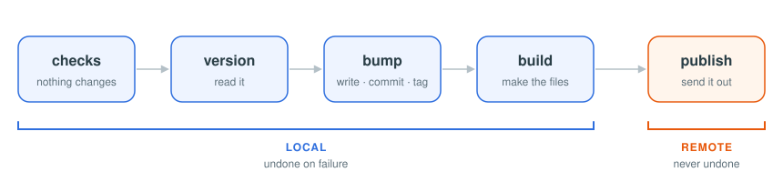

# shipo

**Ship out of the box.** One binary and a few lines of config: bump, tag, build and publish any repo.



- **Out of the box:** presets find the version in your stack; `shipo init` writes the config.
- **One flow for every repo:** it replaces each project's own `release.sh`.
- **Safe:** every check runs first, and a failed local step is undone.
- **Asks before it sends:** a GitHub Release, a workflow and your commands each ask first.
- **Any stack:** JavaScript, Python, Rust, PHP, Dart, Java, C#, Go, Swift, or any file by pattern.

## Install

```bash
brew install diphyx/tap/shipo
# or
go install github.com/diphyx/shipo@latest
```

## Use

```bash
shipo init      # create .shipo for the detected stack
shipo check     # see what a release would do
shipo           # choose the bump, then release
```

```toml
# .shipo
[version]
preset = "javascript"

[build]
command = ["npm ci", "npm run build"]

[publish]
push    = "origin/main"
release = "dist/*.tgz"
command = "npm publish"
```

## Docs

| Page                                        | For                                           |
| ------------------------------------------- | --------------------------------------------- |
| [Get Started](docs/start.md)                | install, a first `.shipo`, a first release    |
| [.shipo](docs/config.md)                    | every key, TOML or YAML, monorepos            |
| [Commands](docs/commands.md)                | the flow, the steps, `check` and the output   |
| [Recipes](docs/recipes.md)                  | ready configs for npm, Go, Python, Rust, Docker |
| [Troubleshooting](docs/troubleshooting.md)  | each error and its fix                        |
| [Agents](docs/AGENTS.md)                    | the one-page reference for AI agents          |

To browse them as a site: `npx docsify-cli serve docs`.

## License

MIT
