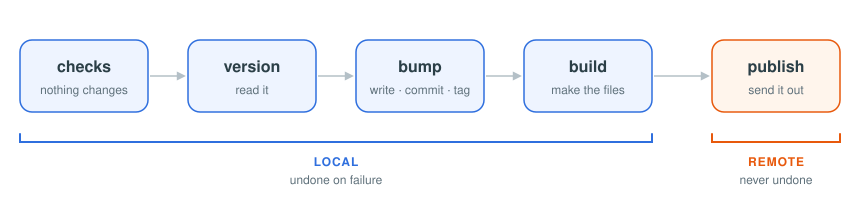

# shipo

**Releases out of the box**

> One binary and a few lines of config: bump, tag, build and publish any repo



```shipo
$ shipo
javascript (1.4.0)

  1) patch    → 1.4.1
  2) minor    → 1.5.0
  3) major    → 2.0.0
  4) current  → 1.4.0
> 2

✓ version    package.json → 1.5.0
✓ commit     chore: release v1.5.0
✓ tag        v1.5.0
✓ build      [1/1] npm run build
✓ push       origin/main + v1.5.0

command    npm publish
Run? [y/N] y
✓ command    [1/1] npm publish
```

## Why

- **Out of the box.** One binary. Presets find the version in your stack, so a few lines of config are enough, and often none.
- **One flow for every repo.** It replaces each project's own `release.sh`.
- **Safe.** Every check runs before anything changes, and a failed local step is undone.
- **Asks before it sends.** A GitHub Release, a workflow and your commands each ask first.
- **Any stack.** JavaScript, Python, Rust, PHP, Dart, Java, C#, Go, Swift, or any file by pattern.
- **Your tools.** shipo calls `git`, `gh` and your commands, with your own logins.
- **For people and agents.** Interactive for you; every step also runs on its own for scripts and AI.

## Good Fit

| Yes                                                        | No                                                  |
| ---------------------------------------------------------- | --------------------------------------------------- |
| anything versioned `MAJOR.MINOR.PATCH`                     | dates or build numbers as versions                  |
| a person choosing the bump                                 | the bump chosen from commit messages                |
| monorepos where each folder releases on its own            | many packages released together in one step         |

Start with [Get Started](start.md).
