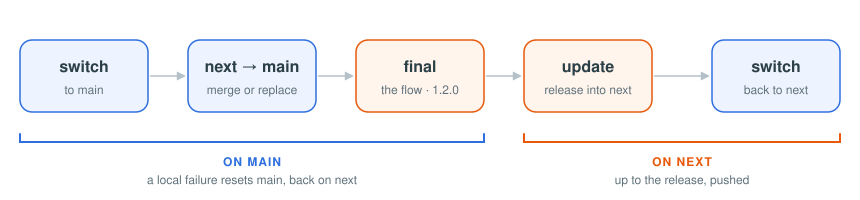

# Bump

> The next version, its commit, and its tag

```toml
[bump]
level  = "ask"
commit = "chore: release v{version}"
suffix = ["next"]
```

## Level

| `level`   | `1.2.3` →        |
| --------- | ---------------- |
| `ask`     | the menu         |
| `major`   | `2.0.0`          |
| `minor`   | `1.3.0`          |
| `patch`   | `1.2.4`          |
| `current` | `1.2.3`, again   |
| `final`   | `1.2.3`, from `1.2.3-next`; with a [suffix](#suffix) |

```shipo
$ shipo
javascript (1.2.3)

  patch    → 1.2.4
❯ minor    → 1.3.0
  major    → 2.0.0
  current  → 1.2.3
```

Move with `↑` `↓` and press `enter`, or press its number. Without a terminal, a number is typed instead.

`shipo minor` on the command line wins over `level`.

## Commit and Tag

- When the push branch has commits HEAD lacks, the bump merges them first, as long as they merge with no conflict; `shipo check` shows `merged before the bump`. A conflict stops the release before any change. Only a `final` you choose to replace `main` with force-pushes, with a lease.
- If the merged commits change the version, the merge is undone and the release stops: run shipo again.

- The commit holds the version files and the lock file. Its message takes [keywords](keywords.md), but not `{hash}`.
- The tag is `v{version}`, `<folder>/v{version}` in a subfolder, or the pattern for git presets.

## Suffix

Branches that release on their own line, such as `next` beside `main`, add their name to the version:

```toml
[bump]
stable = "main"                  # plain releases; the default
suffix = ["next", "release/*"]   # a branch, a glob, a list, or false

[publish]
push = "{remote}/{branch}"
```

| Branch        | `1.2.0` + `minor`   | Tag                  |
| ------------- | ------------------- | -------------------- |
| `main`        | `1.3.0`             | `v1.3.0`             |
| `next`        | `1.3.0-next`        | `v1.3.0-next`        |
| `release/2.x` | `1.3.0-release-2.x` | `v1.3.0-release-2.x` |

- The suffix goes in the version files too, so packages and images don't collide. A `/` becomes `-`.
- `stable` never takes a suffix, so `suffix = "*"` is every other branch.
- The menu shows only the levels that fit the branch and its version:

| On     | Version      | Menu                                                               |
| ------ | ------------ | ------------------------------------------------------------------ |
| `next` | `1.2.0`      | `final` → `1.2.0 on main`, again; `patch` → `1.2.1-next`, `minor`, `major` |
| `next` | `1.2.0-next` | `final` → `1.2.0 on main`, `patch` → `1.2.1-next`, `minor`, `major`, `current` |
| `main` | `1.2.0-next` | `final` → `1.2.0`, `patch` → `1.2.1`, `minor`, `major`             |
| `main` | `1.2.0`      | `patch`, `minor`, `major`, `current`, as with no suffix            |

- `current` needs the branch's own version, so it never reuses another branch's tag.
- With git presets, each branch reads only its own tags: `next` the `-next` ones, `main` the ones with no suffix.
- `{previous_tag}` is the branch's own, or on a first `-next` release, the release it branched from.
- A suffix branch must push to itself; `shipo check` stops a push to another branch.
- Its GitHub Release is a pre-release, never the latest.
- Python and PHP take only some names: name the branch `alpha`, `beta` or `rc`.
- A detached HEAD can't say its branch: a bump stops.

### Final

`final` releases a pre-release as a plain version: `1.2.0-next` gives `1.2.0`.

- On `main`, after you merged `next` yourself, it's a bump like the others.
- On `next`, `shipo final` does the whole round trip, and needs a terminal. `shipo bump final` there stops: the steps never switch branches.



```shipo
$ shipo final
✓ switch     main
✓ merge      next (3 commits)
✓ bump       final · 1.2.0-next → 1.2.0
✓ checks     tools, tree, remote
✓ version    package.json → 1.2.0
✓ commit     chore: release v1.2.0
✓ tag        v1.2.0
✓ push       origin/main + v1.2.0
✓ update     next ← main, push to origin
✓ switch     next
```

#### What It Releases

What was tested: the commit of `next`'s last `-next` tag, not whatever `next` holds now.

- Usually that's `next` itself, and the output says `next`.
- If `next` moved on past its tag, the newer commits weren't tested. They stay on `next`, out of the release, and the menu says `final → 1.2.0 on main, from v1.2.0-next`.
- With no `-next` tag yet, it releases `next` as it is.

#### Merge or Replace

When `main` has commits the tested commit lacks, it asks first:

```shipo
main has 1 commit next lacks

❯ merge    → main + next, with a merge commit
  replace  → main becomes next; drops 156147d, backed up
```

| Pick      | `main` after         | `main`'s extra commits                  |
| --------- | -------------------- | --------------------------------------- |
| `merge`   | them + `next`, merged | released too                           |
| `replace` | exactly `next`       | dropped from `main`, kept in a backup   |

- With no extra commits, it asks nothing: `main` fast-forwards.
- Pick `replace` to release exactly what was tested, when `main` holds work that wasn't.
- `replace` first saves `main` as `backup/main-<date>`, pushed to the remote, so nothing it drops is lost. An earlier backup that day keeps its name; the new one gets `-2`. If the local and the remote `main` diverged, both are saved, the local one with `-local`.
- It then force-pushes `main` with a lease: if `main` moved on the remote since `final` read it, the checks stop it before any change.
- If a `merge` would conflict, the menu says so, and picking it stops before any change.

#### After the Release

- `next` gets the release: a fast-forward, or a merge when it moved on past its tag. It's never rewritten. If that merge would conflict, it's left for you.
- The next `patch` on `next` is then `1.2.1-next`.
- If `v1.2.0` is out already, `final` releases it again, as [`current`](#current) does: the tag moves to the new release commit and is pushed again.

#### Safety

- It needs a clean tree, and fetches first.
- It stops before any change if `origin/next` has commits `next` lacks (pull first), or if `main` released past the version, as `v1.3.0` (bump `next` first).
- A failed local step undoes the bump, puts `main` back and switches back to `next`. A backup stays.
- A failed publish stays on `main`, as nothing is undone once publishing starts. The error says how to finish, with the exact push for a `replace`.

## Current

`current` writes no version and makes no commit. It puts the version's tag on HEAD, and publish runs again:

| The tag is         | `current`       |
| ------------------ | --------------- |
| on HEAD            | kept            |
| missing            | created on HEAD |
| on an older commit | moved to HEAD   |

```shipo
- version    1.2.0 (current)
✓ tag        v1.2.0 moved to HEAD
✓ push       origin/main + v1.2.0
```

Use it to fix a release whose CI failed, without a new version: HEAD's new commits join this version. The push deletes the tag on the remote first, so it's a new tag event and tag workflows run again.

!> A moved tag is a changed tag: anyone who fetched the old one keeps it until `git fetch --tags --force`.

## Safety

- The tree must be clean, with no untracked files.
- A new version's tag must be free, locally and on the remote.
- If a later local step fails, the commit and tag are undone, and a moved tag goes back to its commit.
- Only `current`, and a `final` whose tag is out already, move an existing tag.
