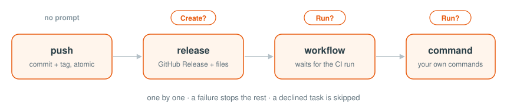

# Publish

> Push, GitHub Release, CI workflow, your commands

```toml
[publish]
push     = "origin/main"
release  = "dist/*.tar.gz"
workflow = "build.yml version={tag}"
command  = "npm publish"
```



```shipo
✓ push       origin/main + v1.5.0

release    v1.5.0 + dist/*.tar.gz
Create? [y/N] y
✓ release    v1.5.0 + 3 file(s)

command    npm publish
Run? [y/N] n
- command    skipped
```

- Each key takes one value or a list, run in order.
- `push` runs as is; the others show what they'll do and ask. `N` skips that task.
- A failure stops the rest. **Nothing is undone**: fix it and run that [step](commands.md#steps) again.

## Push

| `push`                           | Does                         |
| -------------------------------- | ---------------------------- |
| `"origin/main"`                  | push to `main` on `origin`   |
| `["origin/main", "mirror/main"]` | push to each                 |
| `false`                          | skip, and skip release and workflow |

The commit and tag go together, in one atomic push. From a feature branch, both branches are pushed.

## Release

| `release`                          | Does                        |
| ---------------------------------- | --------------------------- |
| `true`                             | a GitHub Release, no files  |
| `"dist/*.tar.gz"`                  | with the matching files     |
| `["dist/*", "checksums.txt"]`      | with files from each path   |

The title is the tag; the notes are generated from the commits. Each path must match a file.

## Workflow

| `workflow`                               | Does                 |
| ---------------------------------------- | -------------------- |
| `"build.yml"`                            | run it               |
| `"build.yml version={tag} os=linux"`     | run it with inputs   |

- The workflow needs `on: workflow_dispatch`, and gets only the inputs you write.
- shipo waits for the run. `shipo workflow --no-wait` doesn't.

## Command

```toml
command = ["npm publish --access public", "docker push app:{version}"]
```

Runs in the `.shipo` folder, like [build commands](build.md#commands). One confirm covers them all.

## Deploy Over SSH

The workflow builds the image; shipo waits, then deploys it:

```toml
workflow = "build.yml version={version}"
command  = "ssh deploy@203.0.113.10 'cd /app && export TAG={version} && docker compose pull && docker compose up -d --wait'"
```
